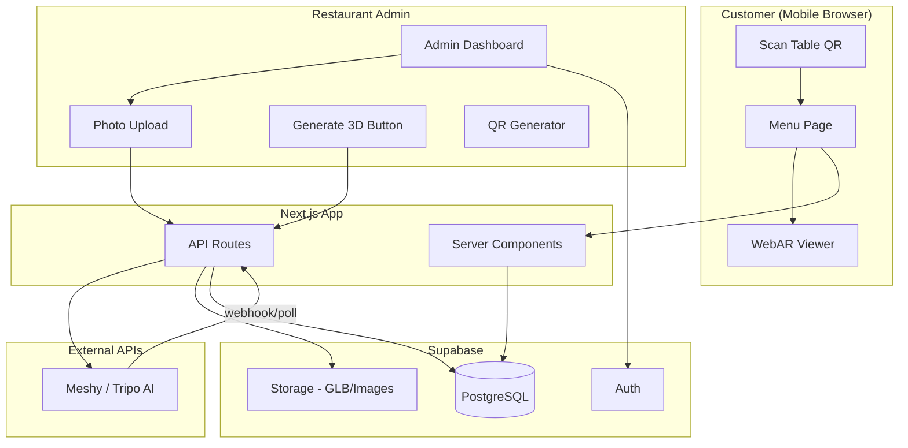

# Architecture

## System Diagram

## Request Flows

### Customer Menu Load

1. User scans QR → `/{slug}/table/{n}`
2. Server component calls `getMenuByTable(slug, n)`
3. Returns restaurant + categories + items
4. Client renders mobile-optimized grid

### AR View (Phase 2)

1. User taps "View in AR" on item
2. Navigate to AR page or open `<model-viewer ar>` inline
3. Model loaded from `menu_items.model_url` (CDN/storage)
4. Browser launches Scene Viewer (Android) or Quick Look (iOS)

### AI 3D Generation (Phase 4)

1. Admin uploads food photo → stored in Supabase Storage
2. Admin clicks "Generate 3D" → `POST /api/ai/generate-3d`
3. API sends image URL to Meshy, stores `ai_job_id`, sets status `processing`
4. Poll or webhook on completion → download GLB → upload to storage → update `model_url`

## Key Design Decisions

- **Data layer abstraction** (`lib/data/menu.ts`): switches mock ↔ Supabase via env flag
- **Server Components first**: menu pages are RSC for SEO and fast first paint
- **AI provider interface**: swap Meshy/Tripo without changing admin UI
- **Row Level Security**: public read on menus; admin write requires authenticated user linked to restaurant
